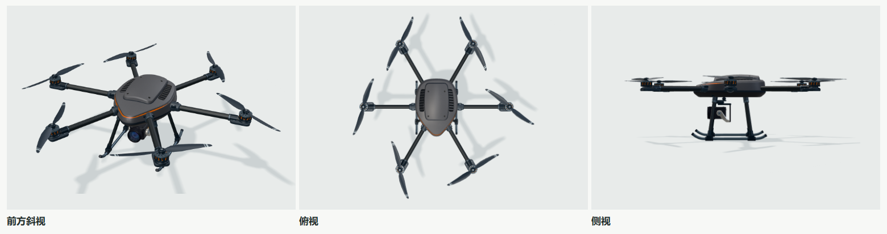
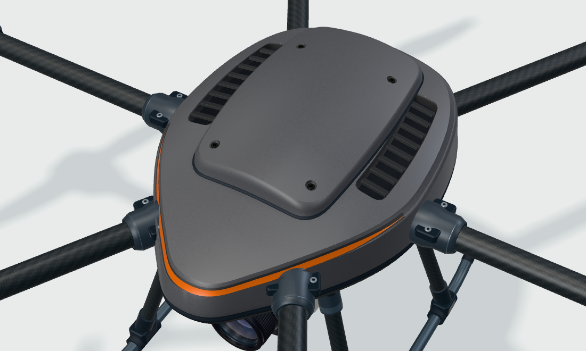
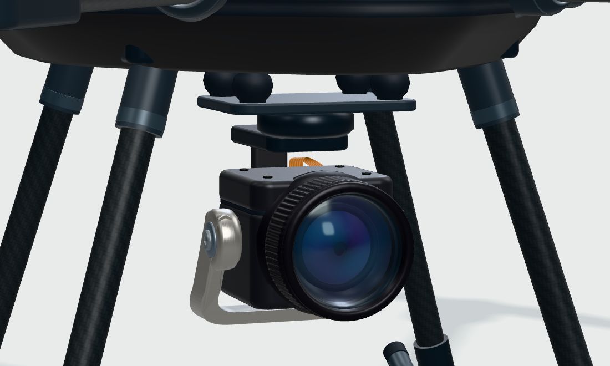
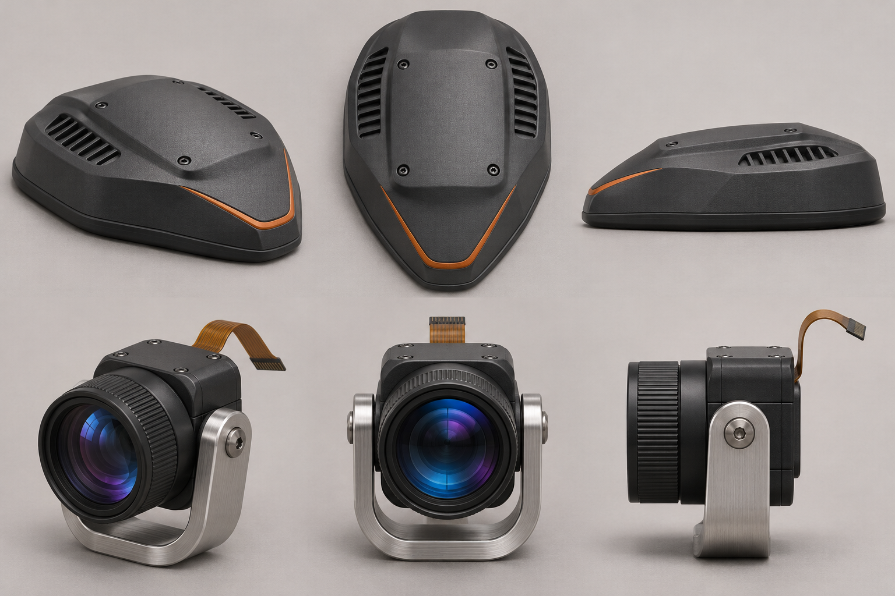

# 基于GPT-6.2 Astra制作的六旋翼无人机

朱华天，GPT-6.2 Astra<br>
2026年11月18日<br>
[GitHub 仓库](https://github.com/ZHT1235456/Three-js-Hexacopter-by-GPT-6.2-Astra)

这是一个用于民用航拍和教学展示的六旋翼无人机模型。整机几何、碳纤维编织纹理和表面材质都由一个 JavaScript 模块生成，可直接嵌入 Three.js 场景。六副双叶桨可以独立转动，双滑橇之间的相机云台可以偏航和俯仰。



[一页中文说明（PDF）](docs/hexacopter.pdf) · [LaTeX 源文件](docs/hexacopter.tex)

## 部件细节

机壳和航拍相机的造型参照了 ImageGen 生成的多视角部件图。石墨灰机盖由四枚沉头螺钉固定，两侧的百叶嵌在壳体开口内。橙色嵌条勾出机头轮廓。云台采用弯折的铝支架，镜头上可以看到对焦环的细槽和内外镜片的蓝紫色反光。[查看参考图的生成提示词](docs/reference/prompt.txt)

| 机壳 | 电机 | 航拍云台 |
| --- | --- | --- |
|  |  |  |

<details>
<summary>展开 ImageGen 部件参考图</summary>



</details>

## 运行交互预览

安装 Node.js 后，在仓库根目录运行以下命令。

```sh
npm ci
npm start
```

打开终端打印的本机地址。拖动可以旋转视角，滚轮可以缩放。用底部按钮查看整机、俯视、侧视、机壳、电机或云台。螺旋桨默认转动，点击「暂停螺旋桨」可以停在当前角度。

## 在自己的项目中使用

将 [hexacopter.mjs](hexacopter.mjs) 复制到已安装 `three` 的项目中，调用 `createHexacopter()` 即可取得一个独立的 `THREE.Group`。下面的示例把模型加入已有的 `scene` 并播放旋翼动画。预览使用 Three.js 0.180.0。

```js
import * as THREE from 'three';
import { createHexacopter, disposeHexacopter } from './hexacopter.mjs';

const drone = createHexacopter();
scene.add(drone);

const mixer = new THREE.AnimationMixer(drone);
const clip = THREE.AnimationClip.findByName(drone.animations, 'rotor-spin');
const spin = mixer.clipAction(clip).play();

// 将镜头下俯 30°。
drone.getObjectByName('gimbal-pitch').rotation.x = Math.PI / 6;
```

在现有渲染循环中，每帧调用 `mixer.update(deltaSeconds)`，传入距离上一帧经过的秒数。将 `spin.paused` 设为 `true` 可暂停，设为 `false` 可从原角度继续。移除该模型时，执行以下清理。

```js
mixer.stopAllAction();
mixer.uncacheRoot(drone);
disposeHexacopter(drone);
```

## 尺度与节点

模型按米建模。六根机臂相邻夹角为 60°，对置电机的轴心相距 0.90 m，中央机身最宽处为 0.27 m。原点位于双滑橇之间的地面上，`+Y` 向上，`+Z` 指向橙色机头。

| 节点 | 在场景中的用途 |
| --- | --- |
| `rotor-1` 至 `rotor-6` | 分别绕局部 Y 轴转动。演示动画每秒一圈，相邻旋翼方向相反。 |
| `gimbal` | 控制整套相机云台的显隐，也可作为替换挂载的位置参考。 |
| `gimbal-yaw`、`gimbal-pitch` | 分别控制云台偏航和镜头俯仰。俯仰节点绕局部 X 轴正转时，镜头下俯。 |

## 编译中文文档

使用包含 `ctex` 和 Fandol 字体的 TeX Live，在仓库根目录执行以下命令即可重新生成单页 PDF。

```sh
cd docs
xelatex -interaction=nonstopmode -halt-on-error hexacopter.tex
```
